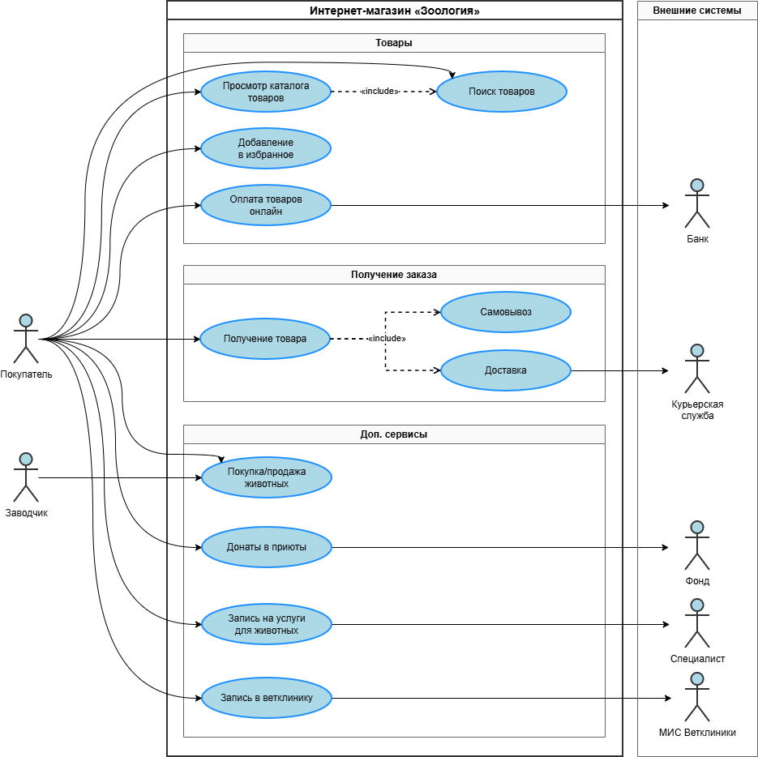
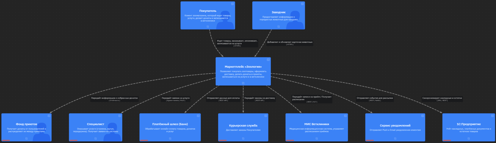

#  Интернет-магазин «Зоология»

## Содержание

1. [О проекте](#о-проекте)
2. [Заказчик](#заказчик)
3. [Цели и задачи](#цели-и-задачи)
4. [Функциональные требования](#функциональные-требования)
5. [Нефункциональные требования](#нефункциональные-требования)
6. [Интеграции](#интеграции)
7. [Дорожная карта](#дорожная-карта)
8. [Бюджет](#бюджет)
9. [UML-диаграмма](#uml-диаграмма)
10. [OpenAPI-спецификация](#openapi-спецификация)
11. [C4-диаграмма (Level 1)](#с4-диаграмма-level-1)
12. [Сроки работы](#сроки-работы)

---

## О проекте

Разработка маркетплейса для сети зоомагазинов **«Зоология»**, включающего:

- продажу кормов и зоотоваров;
- сбор донатов в приюты для животных;
- продажу породистых кошек и собак;
- запись в ветеринарные клиники;
- запись на услуги для животных (стрижка, передержка, выгул).

Проект стартует с **веб-сайта**, затем планируется **мобильное приложение**.

---

## Заказчик

| Параметр | Значение |
|---|---|
| Название сети | «Зоология» |
| Текущий регион | Дальний Восток (5 крупных городов) |
| Количество офлайн-точек | ~20 магазинов (по 4 в каждом городе) |
| Стратегия развития | Выход на Центральную Россию через 2 года |
| Опыт онлайн-продаж | 6 месяцев (соцсети, мессенджеры) |
| Клиентская база | ~1 500 клиентов (Excel) |

---

## Цели и задачи

- Запустить собственный маркетплейс и перевести онлайн-продажи из соцсетей в управляемую платформу.
- Масштабировать бизнес за пределы ДФО.
- Создать экосистему: товары + услуги + ветклиники + благотворительность.
- Построить систему лояльности и персонализированных рекомендаций.

---

## Функциональные требования

### Модуль «Товары»
- Каталог товаров (корма, аксессуары, атрибуты — поводки, игрушки и т. д.).
- Поиск по каталогу с фильтрацией.
- Избранное.
- Корзина и онлайн-оплата (без наличных).
- Получение товара: **самовывоз** или **доставка** (интеграция с курьерской службой).

### Модуль «Донаты»
- Возможность перечислить часть средств в приюты для животных.

### Модуль «Продажа животных»
- Каталог породистых кошек и собак.
- Карточки животных с описанием и условиями.

### Модуль «Ветеринарные клиники»
- Запись на приём в ветклинику.

### Модуль «Услуги для животных»
- Запись на стрижку, передержку, выгул и т. п.

### Модуль «Клиент»
- Идентификация по номеру телефона.
- Система лояльности (скидки, бонусы).
- Персонализированные подборки товаров на основе лайков и истории покупок (рекомендательная система).
- Уведомления: **push** и **email**.

---

## Нефункциональные требования

| Требование | Описание |
|---|---|
| Платформа | Сначала веб-сайт, затем мобильное приложение |
| Оплата | Только онлайн (без наличных) |
| Инфраструктура | Облачные серверы (не собственные) |
| Масштабируемость | Обязательна (учитывая планы выхода в ЦФО) |
| Надёжность | Высокая (SLA-ориентированная архитектура) |
| Безопасность | Защита персональных данных клиентов |

---

## Интеграции

- **1С** — по накладным и платёжным документам.
- **Курьерская служба** — для доставки заказов.
- **МИС ветеринарных клиник** — для записи на приём.
- **Сервисы уведомлений** — push, email.
- **Платёжный шлюз** — онлайн-оплата.

---

## Дорожная карта

Реализация всего функционала рассчитана на **2 года**.

| Этап | Срок | Функционал |
|---|---|---|
| **1** | 0–3 мес. | Продажа товаров (старт) |
| **2** | 3–6 мес. | Донаты в приюты, продажа породистых животных |
| **3** | 6–12 мес. | Запись в ветеринарную клинику |
| **4** | 12–18 мес. | Услуги для животных (стрижка, передержка, выгул) |
| **5** | 18–24 мес. | Мобильное приложение, масштабирование на ЦФО |

---

## Бюджет

**15–20 млн ₽** на весь проект в течении **2-х лет**.

---

## UML-диаграмма

Диаграмма описывает основные сценарии взаимодействия **Покупателя** и **Заводчика** с системой, а также интеграцию с внешними системами: **Банком**, **Курьерской службой**, **Фондом**, **Специалистом** и **МИС Ветклиники**.

[Интерактивная диаграмма в draw.io](https://viewer.diagrams.net/?tags=%7B%7D&lightbox=1&highlight=0000ff&edit=_blank&layers=1&nav=1&title=zoo_market.drawio&dark=auto#R%3Cmxfile%3E%3Cdiagram%20name%3D%22%D0%A1%D1%82%D1%80%D0%B0%D0%BD%D0%B8%D1%86%D0%B0-1%22%20id%3D%22N_Sl9jU5Or0gPNDPdr_l%22%3E7VzZkps4FP0aP4ZCYn80XjKpylRlpmd9ShFbbTPBlgvLveTrRyAJJCHbYGO3uzudKgICCaxz7qoLA2e0evqYJ5vlr3iOsgG0508DZzyAENquT%2F8rWp5ZCwCuzVoWeTpnbVLDXfoD8QtF6y6doy1vY00E44ykG7VxhtdrNCNKW5Ln%2BFG97B5nc6VhkyyQ8hhFw90syVDjsr%2FTOVmy1hAGdfsvKF0sxZ2BH7Ezq0RczAfeLpM5fpSanMnAGeUYE7a3ehqhrJg9dV6me85WD5ajNWnT4e55S9Aqxrv1PMmfm735gFvyLH779jFdZcmaHsWPy5Sgu00yK049Uqxp25KsMnoE6O6WJDnh4EGHNtynWTbCGc5pwxqXQ2xJjr8j0TiADvurzojphUV3vCZ3%2FEGAOGbDA5ces0d9SLIdf9TB2B5EYbGNxwPaJSxbYq%2Fct0V71QI%2FlAejcstOO9J%2BUG7FcHReR3AwjMt7sFMTaRtL%2B47oSO8xLXrF4lFRTtCTNNEco48IrxAp4LCXEo0iB7J%2BjzXnPJ%2B3CeEKObG4aDn8MOGMX1RD16SgO5wXZo58%2Bb74iPF822SHiT39U4WyYjos%2Fpn44pd%2FBnYY2TCEEi5QgMvYQLen4QK9qImLEPBK6SmwuAdg4Tf7nSquZL2gv0e7m9%2B4WdjpXklGUL5OCCpx2zaYUP3KVuT4c%2FR1lJAkw4smPVTiSMSgQ1BV3YIXGg2G43E48U00AJPInk6NasOsFqaSEpiU%2B0CS%2FolQF%2BU1kF02lPgCJcXQlHXaxc%2FoJMTfcrq3KPakXkb2Se2ncNCzG6wAvkYLqNIiOF8zUPDvUJLPlq8O%2B2q6Qwn7YYn0S%2BPkAOcSQE2TB5zTCX9dULnSjANJ5qAkeZ5kyUPeYpA%2FhpktXRaIYStoZadgLN3au5JQAtAD2D%2FSIMz%2FGcdZ8ttfyM2cX9Jo%2BUGQCs2Fa2vwFTUm4F0%2BQxWBviRNC1%2BMJowuzskSL%2FA6ySZ1a5wXRgYVT2bTo%2FqazxhvOHv%2BQ4Q8c%2BOf7AhWuTVH98kuI5%2BTbyiLk9n3RTmi4BTz1GMzFjnKEpI%2BqL%2F3gMn9glM6ExU2XhRZAg%2BODwRQHYX6LQtEeMdzDWk1w69FOplwTCVZVK1jN3VqFNmJJIuxJKOR8MOvI5dhD3I5%2BfppPct2c6R6TKdLpDLMlaUy2S7L%2FsUBWs%2BHRVRd3G6D1qxlmhYTUY6v0glYnha81e46EyejcyFzr4y8UjaZdUDVUgFwhD%2FYlh0EqqltryLEJfj%2BfovOFX2zwra70%2BP2FPNslz9UPCkP6qkZt8C9M6bA9vwjKFKuFoq2umBTYLrdbwc%2BAAgsXyGKEwQy5q26eJZzsI%2FjAMs52IXusGffd9MgtBwY1X%2Bh8aGrH87UScN4NZ%2FMDSxXGcqDlutdyhJSUo9RRiE2JaReXcpBiTZYGOiU22C%2F8yonnLTYU2o%2FxfQBP2zYviO5CgceE6hOyQrggoN3Axqvek9X7OdWg3i35W2dRqSj%2FtdpRGrjQwEFWf8Ajc4KbURa9Jil1LBVfSlx8uuItqcov1mL2sEqdgl1QsuzYRjZIHBcYKvaHuhZ5F6jHvPMvyK5rHIULJGkZQehor8vljNSTT31gs4XtiIiTWffd5vXhshQzhSNVOVXZvlrXCbcol4JF8c5H5Y6jKQQgB5V34uovKvEkTKNZa6cFDQegPCk8AK6keUpLImAzIcWHbzwUKBwglpWONaneX27HDObsdPY1r%2BLxNUSL4hIvonpt5tQmrDXACs9FHWSkyxd0Nkcz%2Bg49Mc7caFM01mSDfmJVTqfMzzRNv3Bn6CYcS4fdHAvHnhj2pKulyhPyR%2FoieyNrMwpoFY6%2FIiAF1pckS64HxSzgGoo9pIjogJ2h%2FKHdIbewjq8sq4ztUSgAhr1GVBdpDt5jd4JvYaxPhL3erAHY00Vw3CdrpLMgFoD0ptyopRwcyjCzSrdXzm0U9GoJfRdyQfz96%2BKV2dD1SurvOix8Nno9nLLcNqSaw9VM0Y97IbtbKnGC82W4iIdcrs53zMN3YEIVQEJeNog%2FUal8iS%2FIqmVFetYXZJjylPoVb4jCy5TsxP1%2BqsIHDiUYzxP4rweJG4%2F4G9b5CLL11whV8OpV5nb7%2BDcuNDJmfppw2MZCVkT8si9HUfyeWLJwIp6UbO1dKXrp2Lk2zOhl4tlXLcHif6LO%2BTvRph9G1iRWsziONp6YK%2FCXM3w25NjWO%2FU8Yqc540lcZRXZIQbfR0RdPRipf6KydqkhMSrA5LgDWcE5%2FHu%2BWWWV%2BiT5c%2F%2F8P7lwb%2FFQZniKQ%2FHT%2FLJ8TM%2FumChA6%2F4eqm0EGzjHDVfAXmfWEnVVt2Txsf0ddekMaDhkLq04LqHS1KaPYALNQYdqi4Beoys1yW3riaB2uqiCIr7N0Nm0vs%2FSd%2Ba9HLV%2BAmsd6OeeQ%2FtyDLzcO9qSaOHKOJty3tgvN8JvIfaY1yZ99FPo23wtPcu5JxpmE9T6wGVGt%2FIt716%2FWiXs1cDzUtKXdTordPp5RSstDrQWb%2BCRgr0fP0KXQt24l%2BzhxdGhxWh6%2BvlpGqPCxE2eEOEfUmfQEqNd6MsVVQ26Ls6W1%2BtPcpX7fqAF7tdlntt1n1%2Bcq%2FNmwF19ujaxhna0DL7gvt9T71HEF1D0%2F309PphG89hXt0LDMOORGv2CCO7V6Lp3DjykZBlsil2d6us7Dio64FKnL7gbUpSXNQFfcOE4NWgWTBEsJb3xTuSpWs0qj7qYndJBh%2F4sAh7%2FG71D3JlvSctyYz4YN2Su34zueuoud1II8TlXhT2WgF8eyVFUEq3s5R8MwFfvRIBGtl9GcrRGYvfpq%2B0VCkuPkzoay%2B9vJnPgZgp5TYpdZB7b0yTyOXoY65PLqMlxJdoqkXYHgqZymn%2F9dPd%2B8awfI2AfUxqCAZs%2FS86Yf2PrexfA%2FxQJPz6ryZ23jcXhlL5hs2tfk0E2cDInwya7vkoULMAhFVzCK1xFbK4YlGm%2F3IN%2F12Thb%2BLNJUIIhfr2Kq%2BkLyRq8AeOOGlYI%2FeN%2BzNOkz3OpD6fFX3ApC2ednMkFYwD2Y3YH%2FtOYaBKYXQPb%2FfP26Gl3zeZsgu12%2FJ73e60nvywhO7Spjuhd31Kz2sv%2F%2FKQrD6M7rO5H8%3D%3C%2Fdiagram%3E%3C%2Fmxfile%3E)

---

## OpenAPI-спецификация

Спецификация API администрирования магазина: [openapi.yaml](openapi/openapi.yaml) или [openapi.json](openapi/openapi.json). Откройте в [Swagger Editor](https://forge.etsi.org/swagger/editor/) и загрузите файл через **File -> Import file**.

Администратор управляет сущностями, показанными на UML-диаграмме: пользователями (покупатели и заводчики), товарами, избранным, заказами, животными, пожертвованиями, услугами для животных и ветклиниками. **Всего 26 путей**.

## С4-диаграмма (Level 1)

Диаграмма описывает системный контекст, демонстрируя границы маркетплейса и его взаимодействие с внешним миром. В центре находится сама система, окруженная пользователями (**Покупатель**, **Заводчик**) и внешними сервисами, обеспечивающими бизнес-логику: платежи (**Банк**), логистику (**Курьерская служба**), благотворительность (**Фонд**), услуги (**Специалист**), медицинские записи (**МИС Ветклиники**), а также уведомления (**Сервис уведомлений**) и учет (**1С:Предприятие**).

[Интерактивная диаграмма в LikeC4](https://playground.likec4.dev/share/BreQqSte8X/view/index/)

---

## Сроки работы

> Дата начала проекта: **октябрь 2026**  
> Плановое завершение: **октябрь 2028**
