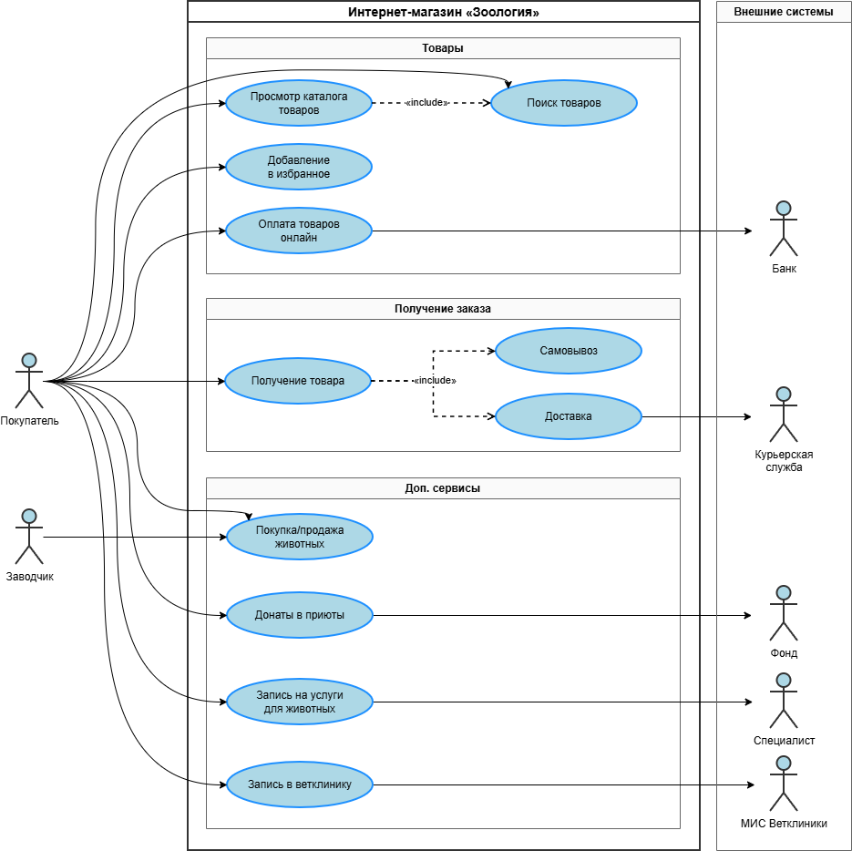

#  Интернет-магазин «Зоология»

## Содержание

1. [О проекте](#о-проекте)
2. [Заказчик](#заказчик)
3. [Цели и задачи](#цели-и-задачи)
4. [Функциональные требования](#функциональные-требования)
5. [Нефункциональные требования](#нефункциональные-требования)
6. [Интеграции](#интеграции)
7. [Дорожная карта](#дорожная-карта)
8. [Бюджет](#бюджет)
9. [UML-диаграмма](#uml-диаграмма)
10. [Сроки работы](#сроки-работы)

---

## О проекте

Разработка маркетплейса для сети зоомагазинов **«Зоология»**, включающего:

- продажу кормов и зоотоваров;
- сбор донатов в приюты для животных;
- продажу породистых кошек и собак;
- запись в ветеринарные клиники;
- запись на услуги для животных (стрижка, передержка, выгул).

Проект стартует с **веб-сайта**, затем планируется **мобильное приложение**.

---

## Заказчик

| Параметр | Значение |
|---|---|
| Название сети | «Зоология» |
| Текущий регион | Дальний Восток (5 крупных городов) |
| Количество офлайн-точек | ~20 магазинов (по 4 в каждом городе) |
| Стратегия развития | Выход на Центральную Россию через 2 года |
| Опыт онлайн-продаж | 6 месяцев (соцсети, мессенджеры) |
| Клиентская база | ~1 500 клиентов (Excel) |

---

## Цели и задачи

- Запустить собственный маркетплейс и перевести онлайн-продажи из соцсетей в управляемую платформу.
- Масштабировать бизнес за пределы ДФО.
- Создать экосистему: товары + услуги + ветклиники + благотворительность.
- Построить систему лояльности и персонализированных рекомендаций.

---

## Функциональные требования

### Модуль «Товары»
- Каталог товаров (корма, аксессуары, атрибуты — поводки, игрушки и т. д.).
- Поиск по каталогу с фильтрацией.
- Избранное.
- Корзина и онлайн-оплата (без наличных).
- Получение товара: **самовывоз** или **доставка** (интеграция с курьерской службой).

### Модуль «Донаты»
- Возможность перечислить часть средств в приюты для животных.

### Модуль «Продажа животных»
- Каталог породистых кошек и собак.
- Карточки животных с описанием и условиями.

### Модуль «Ветеринарные клиники»
- Запись на приём в ветклинику.

### Модуль «Услуги для животных»
- Запись на стрижку, передержку, выгул и т. п.

### Модуль «Клиент»
- Идентификация по номеру телефона.
- Система лояльности (скидки, бонусы).
- Персонализированные подборки товаров на основе лайков и истории покупок (рекомендательная система).
- Уведомления: **push** и **email**.

---

## Нефункциональные требования

| Требование | Описание |
|---|---|
| Платформа | Сначала веб-сайт, затем мобильное приложение |
| Оплата | Только онлайн (без наличных) |
| Инфраструктура | Облачные серверы (не собственные) |
| Масштабируемость | Обязательна (учитывая планы выхода в ЦФО) |
| Надёжность | Высокая (SLA-ориентированная архитектура) |
| Безопасность | Защита персональных данных клиентов |

---

## Интеграции

- **1С** — по накладным и платёжным документам.
- **Курьерская служба** — для доставки заказов.
- **МИС ветеринарных клиник** — для записи на приём.
- **Сервисы уведомлений** — push, email.
- **Платёжный шлюз** — онлайн-оплата.

---

## Дорожная карта

Реализация всего функционала рассчитана на **2 года**.

| Этап | Срок | Функционал |
|---|---|---|
| **1** | 0–3 мес. | Продажа товаров (старт) |
| **2** | 3–6 мес. | Донаты в приюты, продажа породистых животных |
| **3** | 6–12 мес. | Запись в ветеринарную клинику |
| **4** | 12–18 мес. | Услуги для животных (стрижка, передержка, выгул) |
| **5** | 18–24 мес. | Мобильное приложение, масштабирование на ЦФО |

---

## Бюджет

**15–20 млн ₽** на весь проект в течении **2-х лет**.

---

## UML-диаграмма

Диаграмма описывает основные сценарии взаимодействия **Покупателя** и **Заводчика** с системой, а также интеграцию с внешними системами: **Банком**, **Курьерской службой**, **Фондом**, **Специалистом** и **МИС Ветклиники**.

---

## Сроки работы

> Дата начала проекта: **октябрь 2026**  
> Плановое завершение: **октябрь 2028**
